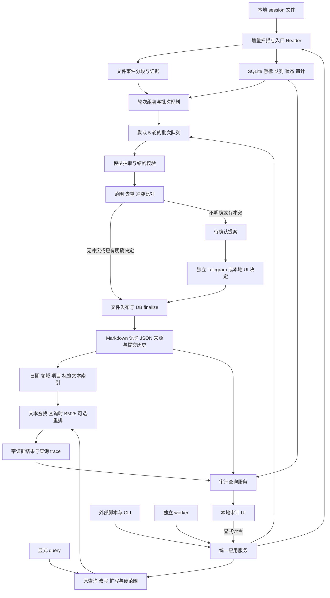

# Memory Agent 总体架构

Memory Agent 独立运行：定期扫描本地 Claude Code/Codex session 增量，以文件保存证据与记忆，以 SQLite 管理状态、队列和审计。小模型按默认 5 轮的小批次抽取；显式查询可使用查询时 BM25 和 query 改写/扩写。项目提供脚本接口与本地审计 UI。

## 架构图

所有模型输出都是提案；文件提交和 SQLite 状态由程序验证。UI 与 CLI 复用应用服务，不各写一套业务规则。周/月整理作为 worker 的独立任务，在增量追平后的有效快照上运行。

## 层级与模块责任

| 层 / 模块 | 确定输入 | 输出 | 边界 |
|---|---|---|---|
| SourceReader | 配置 roots、文件身份/游标、完整原始记录 | 标准事件、位置与诊断 | Claude/Codex 分离，不把内部格式当稳定公开协议 |
| Scanner | 文件增量与 Reader 输出 | segment、DB 事件引用、推进后的游标 | 不调用模型；先文件耐久再 DB 登记 |
| Turn assembler | 带 role、turn/parent、branch 的事件 | open/closed/incomplete 轮次 | 工具调用不是额外一轮 |
| Batch planner | 轮次、目标覆盖、5 轮/token policy | BatchSpec 与 target/context_only 分配 | 不跨 session/branch 混批，不重复分配目标 |
| Batch executor | 稳定批次、lease、模型预算 | 抽取工件、校验结果或重试状态 | 弱模型只处理有界任务，失败不是 no_memory |
| Reconciler | 候选、同批与已有效的相交记忆 | 新增/补证/澄清/冲突/拒绝提案 | 不按时间更新或入口差异自动覆盖 |
| Commit service | 已校验变更、基准版本、batch coverage | 文件快照、DB finalize、audit/outbox | 文件与 DB 间有恢复协议，不假装一个事务 |
| Memory store | 记忆、证据、提案、分类版本 | 不可变文件、manifest、HEAD | 文件是内容权威；SQLite 投影可校正 |
| State store | 游标、队列、lease、job、调用、审计 | state.sqlite | 唯一运行状态源，不与 JSON 状态并存 |
| Recall | 显式请求、当前快照、query plan | 可溯源结果、查询 trace | BM25 仅在此；先过滤范围再送模 |
| Organizer | 变更领域、检索反馈、原子证据 | 周/月分类与摘要提案 | 浓缩不丢例外、不改变用户范围 |
| Model router | 类型化任务、能力/预算/隐私策略 | 结构化结果与用量 | provider 不自由写文件、联网搜用户或通知 |
| Telegram | outbox 与用户 update | 通知回执、DecisionEvent | 本项目单接收器，决定持久化后推进游标 |
| Audit query | DB 元数据与文件引用 | 可分页的 UI DTO | 浏览不调用模型，展示投影/覆盖状态 |
| Interfaces | CLI JSON、HTTP、显式 skill、可选 MCP | 统一命令/查询 | 只翻译协议与校验身份，不复制业务逻辑 |

## 部署形态

一个 Python 包提供核心 CLI、worker 和本地 HTTP/UI 适配。`memory maintain` 可直接完成一次扫描→计划→处理；`memory worker` 按配置常驻运行；`memory ui` 只启动本地审计界面。三者共享 vault 和锁协议，不要求任何个人中控服务。

SQLite 在本机磁盘，证据/记忆同样在 vault。操作系统服务管理器可托管 worker；首版 macOS 提供 launchd 配置建议，后续其他系统仅替换托管方式。关闭 worker 不影响读取旧快照；原 session 由各入口继续写入，待下次扫描发现新增。

审计前端 React/TypeScript/Vite 构建成随包分发的静态资源，由 FastAPI 本地提供。Telegram 直接接 Bot API，不依赖聊天桥接。CLI 的同步路径不需要 HTTP 或 UI 常驻。

## 关键技术取舍

- 内容仍以 Markdown/JSON 文件为权威；SQLite 用于状态和审计，避免为游标/lease 自造一套文件数据库。
- 不用 ES、向量 DB 或 SQLite FTS。查询时在内存对允许读取的语料计算 BM25，缓存可随时丢弃。
- 录入采用后台扫描，不要求 Agent 前台 hook；未来可选 hook 只能提示哪个源文件发生变化，正确性仍依靠扫描。
- 默认 5 轮 + token 双限制；先抽取，再独立比较范围和冲突，适配能力较弱的模型。
- 一个协调器和明确任务类型足够；首版不引入自治多 Agent 网络或通用调度平台。
- 接口合同是唯一入口定义；UI、脚本、Telegram 的决定走同一应用服务与版本校验。

## 关键不变量

1. 源文件扫描进度、目标分批覆盖和记忆消费结果分开，不互相冒充。
2. 原始用户、助手、工具和重放历史的角色/来源保留；只有明确用户证据确认偏好。
3. 一条记忆一个稳定 ID，多个索引视图不复制另一份真相。
4. 未决冲突不自动覆盖，scope 不清不扩大范围；当前任务明确指令优先于历史记忆。
5. 批次重试不重复消费，no_memory 是校验过的结果，空白/异常不是成功。
6. 同批、相邻批与跨入口的相关要求都参与冲突检查。
7. 原 query 始终保留，改写/扩写不修改硬范围、否定、精确实体与时间约束。
8. 文件 HEAD 与 DB finalize 可恢复；提交前检查基准版本，恢复未完成 intent 后才继续发布。
9. 审计能追溯原话、模型输入范围、候选与提交，不记录隐藏思考或秘密。
10. 删除清单优先于旧快照/旧数据库，恢复不能悄悄复活已忘记的内容。

输入/队列细节见 [扫描与分批](09-session-scan-and-batching.md)，外部接口见 [脚本与服务](10-script-and-service-api.md)，数据归属见 [状态与审计](12-state-and-audit-data.md)，实现边界见 [代码结构](13-code-layout.md)和[开发工作包](07-delivery-and-evaluation.md)。
