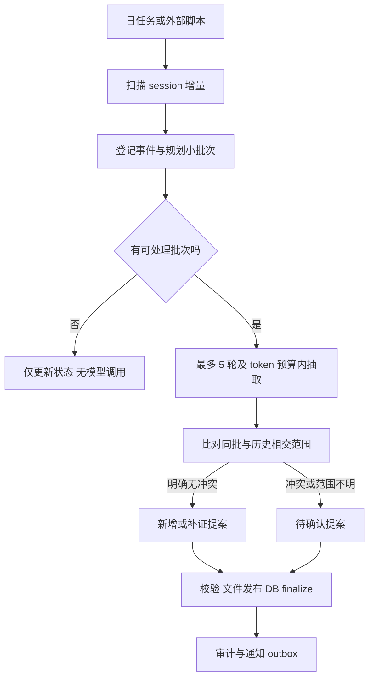

# Memory Agent 记录整理与召回流程

整理的单位是有来源的原子记忆。后台先扫描本地 session 增量，组成默认 5 轮的小批次，再抽取、比对并发布；周整理检查分类，月整理检查聚合与浓缩。来源文件、批次执行和记忆生效具有不同进度。

## 扫描和记录

扫描器只读取允许目录中的完整新增记录，通过 Claude Code/Codex Reader 生成 ConversationEvent，先保存 segment 文件，再在 SQLite 登记事件和推进游标。历史对话里的“记住”可作为更强的抽取意图，但不会在扫描时执行命令；“回忆一下”也不能触发自动召回。

轮次组装保留用户→助手/工具的关系。默认最多 5 轮一批，总输入预算同时限制；20 轮通常 4 批，长轮次会进一步缩小或拆片。上下文不足进入 needs_context，不能只拿最后一句推断范围。详见 [扫描与批处理](09-session-scan-and-batching.md)。

模型先区分明确要求、自述、一次性问题、引用、假设和助手建议。抽取每条原句、规范表述、范围、期限、原则/细节、强度和不确定性。可独立改变的要求拆成独立候选，否定、例外与条件保留。显式“记住”仍经过冲突检查。

隐私排除与明显秘密遮盖在送模前执行；扫描不把整份工具输出或所有历史对话默认传给云模型。裁剪、context_only 和未评审范围进入审计，不伪装成模型读过全部。

## 每日增量处理



SQLite 中的批次 retry_wait/failed 不影响已接收的源游标；重试从持久批次和工件恢复，不能重新取一段不同上下文却沿用旧 batch ID。已发布消费结果以 commit manifest 为准，DB 通过 intent 恢复对齐。无记忆候选也要保存 validated no_memory，异常空结果不算成功。

同 session 顺序处理；相邻批、同批和跨入口的新要求都与最新相交记忆比对。范围候选须包括历史有效原则，不限最近 30 天，不因入口不同隔离冲突。后台的冲突候选选择不依赖查询时 BM25。

批次发布待决提案后可以 completed；待决是业务状态，不是执行失败。继续处理后续批次时读取这些开放提案，避免相同疑问重复发消息。小模型抽取和 reconcile 分开，遇到不确定范围请求补充而非强迫猜测。

## 冲突分类

| 关系 | 例子 | 处理 |
|---|---|---|
| 等价重复 | “通常用中文回复”与“默认中文回答” | 规范表述不变，增加独立来源；同一事件重放不增加证据计数 |
| 互补细节 | “截图用 PNG”与“截图保留原尺寸” | 各自保留，关联到同主题 |
| 范围不同 | A 项目用 Python，B 项目用 TypeScript | 并存，项目 ID 是范围；入口不是范围 |
| 明确局部例外 | “以后不兼容旧配置，但这个迁移项目除外” | 原则与例外同时保存，引用同一明确说明 |
| 可能的局部例外 | 已有不兼容原则，新说“这次兼容旧配置”但“这次”指代不清 | 请求澄清范围，不自动扩成全局更新 |
| 真冲突 | 同项目同阶段既要求保留又要求移除同一兼容层 | 人工确认后决定更替/拆分/保留 |
| 事实随时间变化 | “我从 A 城搬到 B 城” | 保留时间关系；涉及既有事实更替时首版仍生成可确认提案 |
| 明确更正 | “上次记错了，我说的是 A，不是 B” | 绑定旧记录生成更正提案；不必重问已明确的更正，但必须验证引用对象唯一 |
| 来源不可信 | 助手推断“用户应该偏好 X” | 不确认为用户记忆，留诊断或丢弃 |

用户直接发出“将 mem_123 改为 X”且对象、范围和文本都明确时，视为已经给出的人工决定，不再次机械确认。普通会话中的新要求与旧记录矛盾，仍走待确认流程。

判断逻辑是：主体/predicate 可能相关 → 作用域和有效时间有交集 → 模态与条件同时适用 → 内容不能同时满足。任一步信息不足，结果是 clarify，不是强行 true/false。

## 冲突提案与人工决定

每个提案包括：稳定冲突 ID、旧记忆 ID/revision、候选及其原话、双方范围和时间、冲突理由、可选操作、提案版本、生成时的基准提交。重复候选合并到同一开放提案，但不能隐去新增证据。

Telegram 展示示例：

> Memory Agent 待确认：Memory Agent 项目的存储方式。
> 旧要求：只用文件。来源：10 月 8 日，Claude Code。
> 新要求：可以引入 SQLite 索引。来源：10 月 12 日，Codex。
> 适用范围：同项目，尚未说明是否替换旧要求。
> 选择：采用新要求 / 保持旧要求 / 按范围并存 / 稍后处理。
> 查看完整原话可用本地冲突 ID。

“按范围并存”通常需要进一步说明，例如仅开发调试使用 SQLite；不能点击按钮就自动构造不存在的例外。“采用新要求”提交新版本并把旧版本标为被替代；旧证据仍保留。“保持旧要求”拒绝该候选，并记录决定，避免同一候选反复提醒。

身份校验包含允许的 chat/user、一次性随机 token 或签名、conflict ID、proposal revision、有效期。回调 token 不包含完整记忆正文。首版由本项目的 Telegram 适配器长轮询接收，使用项目配置的凭据和允许的发送者名单；消息持久化与游标推进遵循同一幂等协议，不依赖现有桥接服务。

同一用户话语经多个桥接器镜像传入时，优先用明确的 origin/message lineage 合并来源，不把镜像算作多次独立表达。没有可靠 lineage 时只记不同观测来源，不据此增加“独立支持次数”或提升适用范围；语义去重和传输幂等是两个步骤。

重复消息和重复按钮按 decision ID 幂等；晚到的按钮若基准记忆已变更则拒绝应用，返回新的比较提案。同一 proposal revision 使用 compare-and-swap：第一个有效且成功提交的终结决定消费该 revision，随后到达的相反决定不能再次改变它。稍后处理只改变提醒状态，不终结提案。系统回执显示实际采用的决定；用户改主意时生成引用当前状态的新更正提案。不能相信 Telegram 不存在的客户端点击时间字段，也不通过“最后收到就赢”猜测意图。

自由文本回复只产生解析候选，模糊答复如“随便”不得落成覆盖决定。

无回复保持 pending，旧要求继续保留；召回同时说明相关冲突尚待确认，必要时请用户决定当前任务采用哪条。提醒按主题合并并限频，可稍后、静音或本地处理；Telegram 不可用不阻断无冲突记忆提交。

通知 outbox 在文件提交后投递，采用至少一次发送，稳定通知 ID 便于识别重复。已提交的开放冲突是待通知的依据，outbox 由 conflict ID + proposal revision + channel 确定性派生；每次维护都补齐缺失发送项，避免 HEAD 已提交而 outbox 未创建时崩溃导致永远漏发。无新增记忆时仍可恢复通知和清理任务，模型调用保持为零。不能承诺跨网络“恰好一次”。用户的确认写回本地收件箱后才由单写入者提交；发送按钮不直接改 memory 文件。

## 初始领域树

领域 ID 固定，中文名、别名和展示路径可变。下图是冷启动建议，不是必须填满的目录：

```text
个人 personal
  沟通与表达 communication
  工作习惯 work-habits
软件工程 software
  编码与重构 coding
  测试与审查 quality
人工智能 ai
  Agent 与记忆 agents
    记忆系统 memory
    多 Agent 协作 orchestration
  AI 编程 coding-tools
  多媒体生成 media
    图片生成 image
    视频生成 video
    音频生成 audio
信息研究 research
  搜索与来源 search
  阅读与信息整理 synthesis
环境与自动化 operations
  本机环境 environment
  调度与集成 automation
```

AI 画图、AI 生图、图片生成映射同一 ID；ComfyUI、Qwen、SeedVR2 等先作为工具标签，积累足够稳定的独立需求后再考虑子域。通用编码规则以软件工程为主域，在 AI 编程视图中通过关联和上位适用原则可见，避免维护两份编码规则。

每个领域登记 `id/name/parent_id/aliases/description/include_examples/exclude_examples/status`。项目另有稳定注册表，记录 root path、repo 标识及别名，同一 repo 的 worktree 映射同项目；临时同名目录不能自动合并。来源 Agent 只是 provenance，不决定适用范围。

默认 2–3 层，最大建议 4 层；更深时先评估标签和链接能否解决。一条记忆通常 1 个主域、至多 2 个关联域；不确定进入 uncategorized 待整理，不为了填表创造新领域。

## 三档摘要和抽象层级

| 档位 | 目的 | 典型大小 | 内容 |
|---|---|---|---|
| 领域导航 | 判断应该查哪个领域 | 每域约 50–100 tokens | 一句定义、别名、子域、涵盖/不涵盖内容 |
| 领域概览 | 显式召回后快速把握规则 | 每域约 400–800 tokens | 有效原则、关键细节、项目例外、冲突提示，逐条 ID 引用 |
| 原子细节 | 执行与核对 | 按需分页 | 完整条件、原话、范围、时间、版本与证据 |

这些是控制上下文的预算档位，不是信息保留期限。长期/短期与原则/细节分开：短期也可以有原则，长期也可以有具体细节。摘要超过预算时拆成子主题或分页，不能删掉难以浓缩的例外。

摘要带 `source_commit_id`、`member_ids_and_revisions` 和生成策略版本。任何成员变更、过期或待决冲突变化都使摘要失效；召回可以直接读取原子记录，不能为了展示摘要而等待模型。缓存摘要仅对匹配的成员版本有效。

领域导航只含领域定义，不嵌入跨项目的具体要求。领域概览的每一段必须能关联到原子成员 ID；召回先按项目、条件和隐私过滤原子集合，再用完全匹配该集合的摘要。跨项目混合概览不能先送给模型再要求它忽略无关项目；没有匹配摘要就从过滤后的原子条目即时编排，或直接返回原文。摘要缓存键包含 scope/filter fingerprint 和成员版本。

## 周级分类复查

每周只对有增量或检索反馈的领域检查：未分类比率、领域大小、标签同义重复、跨域命中、误路由、过深路径、摘要遗漏。每次按确定性指标筛选少数问题领域，再调用模型提出结构调整。

可用默认触发指标：一域超过 30 条且可分为至少两个各 8 条的稳定主题，考虑拆分；相邻同义域连续两次评审高度重叠，考虑合并；长期只有几条的领域建议并回父域。数量仅触发评审，不直接执行迁移；用户真实用途比计数更重要。

每份变更提案给出新旧树、受影响 ID、5 条代表样例、检索回放变化和回退方法。仅摘要刷新、已知别名规范化等不改变意义与作用范围的操作可自动执行。跨根移动、合并语义不完全相同的域、从项目提升到全局的提案需确认。

分类路径不是 scope 的唯一真相。领域范围记忆保存所引用的稳定域 ID 与适用范围基准；任何调整若改变该要求的实际覆盖集合，就属于范围变更，必须重新校验/确认，不能把目录整理偷偷变成偏好扩大。任何 reparent、split、merge 都计算 `effective_scope_diff`：祖先链、可继承约束或实际适用对象集合有变化时必须确认，即使变更仍发生在同一根域。展示名称/别名修改且该差异为空才可自动执行。

## 月级浓缩和聚合

先完成缺失的日整理，再检查跨域重复、通用原则候选和所有摘要的证据覆盖。月级重整可以从多个原子记忆提出更一般的概述，但重复频次不授权提升为全局原则。

对摘要进行双向验证：摘要中的每个要求有证据；来源中的否定、范围、例外、期限在摘要或明确的详情链接中可找回。若模型无法生成忠实摘要，保留原子条目清单。

旧领域改名保留别名/redirect ID，旧日期索引和来源路径不重写。归档内容仍可在 `include_archived` 的显式查询中查找；无引用不等于无价值，不能据此自动遗忘长期偏好。

## 显式召回

首选命令式触发，例如 Claude Code 的 `/memory recall …`、Codex 的显式 memory skill 调用或本地 `memory recall …`。自然语言关键词“回忆一下”“查我的记忆”可作为后续便利入口，但必须处于当前用户消息的意图位置，不能因代码块、引用、否定句或工具结果出现词语而触发。

召回返回原子记忆或概览时始终带：适用范围、原话/来源、有效时间、未决冲突、快照版本和截断状态。用户可继续展开到证据。输出只作为当前用户请求的辅助上下文，不写入系统提示词、CLAUDE.md 或 AGENTS.md。

工具如果只有模型发来的 `explicit=true`，无法证明是用户主动触发。优先由可观察用户事件的适配器发出短期 trigger token；无法做到时只承诺命令/skill 层的显式使用约定，并在能力矩阵中明确其约束，不能宣称具备不可绕过的硬门控。
