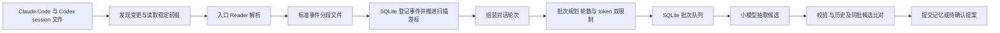

# Session 增量扫描与小批处理

自动记录的入口是本机 session 文件。扫描器从文件增量中产生标准事件，事件先持久化，再按连续对话组成处理批次。文件扫描不调用模型，抽取批次默认最多 5 轮；首次接入与历史回填均有明确范围。

## 完整链路

“轻量”具体指只读取新增完整记录、确定性解析、角色标注和落盘；不是要求每个 Agent 在前台再执行一次模型抽取。Hook 不作为首版自动记录的依赖。外部脚本也可以调用扫描/导入接口，进入相同链路。

## SourceReader 接口

| 方法 | 输入 | 输出 | 边界 |
|---|---|---|---|
| discover | 配置中的允许目录、文件清单、扫描模式 | SourceFileDescriptor 列表 | 只遍历显式 roots；mtime/size 是发现线索，不是消费依据 |
| inspect | 文件描述、已知 generation、游标 | ScanDisposition | append / unchanged / replaced / truncated / unsupported |
| read_delta | 文件描述、完整记录偏移、读取上限 | RawRecordPage | 只返回读取开始时文件大小以内的完整记录 |
| normalize | 完整原始记录、adapter 版本、会话分支信息 | ConversationEvent 列表与诊断 | 去除同一消息的双重日志表示，不能把工具/助手改标为用户 |

Claude Code、Codex 分别实现 Reader；具体 roots、glob 和支持的记录形状由安装配置与脱敏 fixture 验证，不把私有日志格式宣称为稳定 API。不扫描笼统的整个 home，也不把命令历史文件当成完整 session。正文与元信息存在于不同文件时，Reader 显式登记关联，不凭同名路径猜测。

首版只处理配置的本地主机文件。session/branch/parent message ID 优先读取原生标识；子 Agent、fork 和重放历史各自保留 lineage。继承的旧消息是 context_only，不作为新的用户表达。相同用户内容若在日志中同时出现消息体与 UI 事件，Reader 选择单一权威表示，另一条只记来源别名。

## 扫描范围与首次运行

持续扫描根据每个文件的游标推进，而不是筛选“今天创建的 session”。昨天的 session 今天追加的消息、三天前未处理的增量、迟到写入都必须处理；source_time 用于日期索引，discovered_at 用于追踪何时发现，二者不能混用。

首次初始化默认从安装时刻起记录：登记现有文件完整记录边界，后续只处理新内容。需要导入今天或其他历史范围时显式指定 `init --since today` 或 `scan --since ... --until ... --mode backfill`。backfill 有独立扫描运行与范围，不把未选择的历史区间误标为连续扫描已消费。可读取范围开始前少量上下文作消歧，但不能把这些上下文重新当作目标抽取。

普通扫描可每 15 分钟做一次，日整理前强制再扫一轮；两个频率均可配置。每天只运行一次 `memory maintain` 也能完成扫描、规划和处理，不要求常驻 worker 才能工作。这里是开发默认建议，本轮不读取真实 session 或创建定时任务。

## 增量游标与原子接收

SQLite 的 source_files 保存 source_file_id、connector、session/branch、canonical_path、file identity、generation、adapter_version、complete_offset、边界记录 hash、已见 size/mtime、last_scan_at 和故障信息。文件 identity 与 session 标识组合使用，不能只凭路径或 inode 区分会话。

1. 获取该 source 的短期扫描锁，读取当前 generation 和游标；冻结本次读取上界为打开文件时的 size。
2. 在字节层读取，只有完整换行记录及完整 UTF-8/JSON 才交给 Reader。半行、半个字符留到下一次，不能推进游标越过它。
3. 将规范化事件及必要证据写入一个不可变 segment 文件，临时文件写完、fsync 后原子 rename。segment 包含原始位置与正文 hash。
4. 在一个 SQLite 短事务中登记 segment、插入幂等事件引用、更新 complete_offset。事务提交后事件才对批次规划器可见。
5. 文件写成但 DB 未提交即崩溃：文件是孤立工件，可复用或清理；游标没前进，重扫依靠稳定事件键去重。DB 提交后不能因模型失败回退扫描游标。

同一路径缩短、被替换或边界 hash 不符时创建新 generation 并重新对齐。改名且文件 identity/session 一致可沿用进度；无法证明一致就重新读取并去重。源文件被重写时，旧消息修订生成 supersedes_event_id，依赖旧版本的待处理批次失效；已形成的记忆进入来源更正比对，不能静默保留成最新要求。

不只检查尾部：对发生变更的文件验证已读前缀或分块 hash，定期清查注册文件，发现中部改写与新文件。mtime 不足以证明未变化。损坏的完整记录进入 source error，保留字节位置；默认不跳过未知记录并继续声称无缺口，用户可显式隔离该记录后恢复后续扫描。

## 标准事件与一轮对话

ConversationEvent 至少包含 event_id、logical_message_id、revision_hash、connector、session_id、branch_id、parent_id、turn_key、role、kind、source_time、discovered_at、segment_ref、byte/record locator、text、origin、privacy 与 replaces_event_id。实际示例见数据文档。事件 ID 由稳定来源标识和正文版本确定；没有原生 ID 时使用 adapter 定义的 session/branch/记录锚点组合，不能仅按相同文本把两次表达合并。

一轮是一次逻辑用户输入，以及其后属于该输入的助手回复和工具过程，直到明确 turn 完成或下一条用户输入。优先采用原生 turn ID；没有时使用可验证的顺序规则。一条 tool_call、一段 streaming chunk、一条 JSONL 记录都不自动计成一轮。中途插入的新用户输入按新轮处理，前轮标为 interrupted；不能合成用户从未连续说过的一句话。

轮次状态为 open、closed 或 incomplete。当前尚在写的尾轮先等待；来源明确结束/中断，或达到可配置静默阈值后可作为 incomplete 提交规划，并显式注明缺少回复。随后补齐的消息作为同一逻辑轮次的新 revision 重新比对，不重复记录旧用户主张；助手新增回复本身不产生新用户证据。

## 默认分批策略

| 参数 | 默认建议 | 说明 |
|---|---:|---|
| max_turns_per_batch | 5 | 针对能力较弱的离线模型，可调到 10，但不是按 10 轮固定切 |
| max_input_tokens | 6000 | 包含系统任务说明、当前轮次、上下文补充、schema；与实际模型窗口取更小限制 |
| max_output_tokens | 1500 | 为候选 JSON 留预算，另保留安全余量 |
| context_prefix_tokens | 512 | 只放项目事实和可核对的前文原句，计入上述输入预算 |
| overlap_turns | 0 | 默认不整轮重复；需要时可调 1，且计入每批 5 轮上限 |
| max_attempts | 3 | 首次加最多两次暂时性重试；格式修复最多一次且共享总预算 |
| concurrency | 1 | 首版模型任务串行，可在实测后增加跨 session 并发 |

按 session + branch + 项目 + 隐私策略分组，再按逻辑轮次顺序贪心装箱。达到 5 轮或 token 上限就封批。批次不混 session，领域判定在抽取后进行，不能在扫描时为按领域分组而切断对话。

20 轮均在预算内时：B1=1–5，B2=6–10，B3=11–15，B4=16–20。12 轮则为 5+5+2；每日扫描结束/达到等待上限时释放不足 5 轮的尾批，不无限等凑满。5 轮已超预算时，可变为 3+2 或更小批，轮数是上限而非必须凑齐。

如果启用 1 轮重叠，上下文轮也计入 5 轮：第一批 1–5，第二批旧第 5 轮作 context_only 加新 6–9，依此类推。context_only 不产生新消费单位或重复支持次数。扫描事件的时间索引仍保持原时间，批次可以跨自然日。

## 长轮次与跨批次指代

单轮本身超预算时，先保留用户原话、直接相关助手解释和被明确指代的工具片段；大段无关工具输出只提供类型、长度和可定位引用。隐私过滤、内容裁剪与未送模范围必须记录在 audit 中，不宣称模型已审阅整轮。

若用户原话本身超长，按段落/列表等确定性文本边界切为有范围标识的 fragment；片段保留原始 code point span、父轮次 ID、前后关系和必要条件前缀。处理单位变为 work_unit，不把原事件提前标为完全处理。所有目标片段有结果后才能形成该事件的完整处理回执；片段间可能矛盾的要求仍需合并校验。

“按上面说的”“这次除外”等需要前批内容时，优先通过 parent/source refs 回取原句，受 512-token 前缀和总预算约束。可保存 carry_context 帮助定位，但模型摘要不能代替用户证据。找不到指代、不能在预算内保留条件或不适合切分的单元进入 needs_context/oversize 队列，不直接抽象成全局规则；UI 显示缺失原因。

## 队列与三种进度

| 进度 | 权威位置 | 推进条件 |
|---|---|---|
| scan progress | SQLite source_files | segment 已耐久落盘且事件引用登记成功 |
| plan coverage | SQLite work_units/batches/batch_members | 已消费范围被唯一分配到稳定批次；context_only 不占目标归属 |
| memory consumption | 文件 commit manifest，SQLite 为已应用投影 | 候选已验证，active/pending/rejected/no_memory 等结果已提交 |

批次状态：ready → leased → extracted → reconciling → completed。暂时失败进入 retry_wait；多次失败进入 failed，缺上下文进入 needs_context；过期输入进入 superseded，待处理可取消。每次 claim 在 SQLite 事务中设置 lease_token/attempt/heartbeat；最终登记结果校验 token，防止超时旧进程写回。

processed 不等于产生了记忆：明确 no_memory 也需保存结构化结果回执。模型返回空白/坏 JSON/预算耗尽不能当作 no_memory。产生待确认提案的批次可以完成，提案本身仍 pending，不阻塞同 session 后续批次。

同 session 顺序抽取和提交，避免后批在前批尚未登记时忽略新要求；不同 session 也必须在提交时重查最新相交记忆，解决同时新建矛盾记录。重跑优先复用已校验的抽取工件；基准记忆变了只重做 reconcile，不盲目再付一次抽取费用。

batch_id 包含 session/branch、有序 target unit IDs、各正文 revision 和 batch policy 版本。相同目标在同一 extraction epoch 只有一个有效分配；改为每批 10 轮仅影响未计划内容。已计划批次需显式 replan，未提交旧批次先标 superseded；已经提交的目标不能因改变切分参数重复产生记忆。

## 弱模型任务边界

每批先只执行 extract：找用户明确要求、原句、范围、否定/例外与不确定项，返回有限 JSON。classify 使用小词表，可同调用返回；conflict/reconcile 使用该批候选与有限相交历史，单独调用。模型不同时处理 20 轮、全库分类树和月度总结。

输出字段 required、quote/span 严格校验；低能力模型无法给出范围时输出 uncertainty，不强迫猜测。每个 batch 记录实际轮数、目标片段、context_only、输入/输出 token、裁剪原因、模型/提示版本及失败诊断，供审计 UI 查看。预算不足进入待处理，不丢原文、不前推提交状态。
