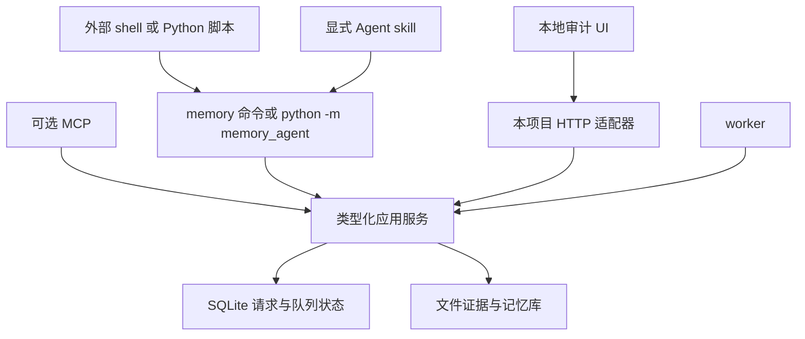

# 脚本调用与服务接口

外部脚本通过项目 CLI 调用应用服务。CLI 可以直接同步执行，也可以把请求登记到 SQLite 后交给 worker；不要求调用者接入 Agent 会话或常驻 HTTP 服务。审计 UI 使用本项目的本地 HTTP 适配器，调用同一套应用服务，不能绕开校验直接写数据库。

## 调用层次



所有写入口复用 contracts 校验、幂等规则、状态迁移和提交协议。脚本传 argv 列表与 JSON stdin，不把会话正文拼成 shell 命令。身份边界为当前 OS 用户；这不是多租户远程服务。

## CLI 契约

所有命令均为计划接口，本轮未实现。安装后提供 `memory` 和等价的 `python -m memory_agent`。公共参数包括 `--config`、`--vault`、`--json`、`--request-id`、`--idempotency-key`、`--timeout`；目录与配置参数只选择已授权本地资源。

| 命令 | 确定输入 | 结果与副作用 |
|---|---|---|
| init | vault、source roots、可选 since；默认从安装时刻起 | 创建格式版本与初始 source 基线；不默认回填全历史 |
| scan | connectors、mode=incremental/backfill、可选日期范围与 max_bytes | 新 segment/events、扫描游标；零模型调用 |
| batch plan | 已登记事件或 scan_id、batch policy | 确定 batch_id 与目标单位；零模型调用 |
| batch process | batch_id 或队列范围、max_batches、预算 | 抽取→校验→reconcile→提交；失败可重试 |
| maintain | connectors、处理上限、预算 | scan→plan→process 的日整理组合，不丢 backlog |
| review | period=week/month、可选 domain、预算 | 分类/摘要提案与安全变更；不改变用户范围而不确认 |
| recall | 显式 query、filters、keyword/bm25 检索方式、改写/扩写开关、limit/cursor | 有证据结果与查询 trace；不扫描或写新记忆 |
| capture | 结构化 ConversationEvent/事件列表 | 外部导入的补充入口；进入同一 segment→DB→batch 流程 |
| call | 一个版本化 JSON 请求 | 通用脚本入口，mode=sync/async；async 登记 job |
| job status/get | job_id | 状态、阶段进度、错误、结果引用；只读 |
| job cancel/retry | job_id、expected_revision、幂等键 | 提交取消/重试意图；已发布内容不回滚 |
| conflicts / decide | 过滤或 conflict_id、proposal_revision、action、补充范围 | 查看/决定；与 Telegram/UI 共用逻辑 |
| worker | vault、并发和预算配置 | 扫描、定时、队列、通知循环；只托管固定类型任务 |
| ui | vault、loopback bind/port | 启动本地审计 HTTP/UI，不自动执行抽取或召回模型 |
| doctor | vault、检查级别 | source 能力、DB/schema、文件引用、intent 恢复诊断；不输出凭据 |

`batch process` 包括发布阶段，不止调用模型。若只希望检查候选，可在测试/影子配置中 `commit_policy=propose_only`，响应明确“仅有提案”；不能把它报成已记忆。

## 通用 Request

```json
{
  "api_version": 1,
  "request_id": "req_daily_example",
  "client_id": "local_script",
  "idempotency_key": "daily-2026-10-08-attempt-1",
  "operation": "maintain",
  "mode": "async",
  "params": {
    "connectors": ["claude-code", "codex"],
    "max_batches": 20,
    "batch_policy": {"max_turns_per_batch": 5, "max_input_tokens": 6000},
    "commit_policy": "validated"
  },
  "limits": {"deadline_seconds": 1800, "max_model_calls": 60},
  "activation": {"kind": "external_script"}
}
```

operation 为封闭枚举：scan、batch.plan、batch.process、maintain、review、recall、capture、conflict.decide、job.cancel、job.retry。各自 params 是 discriminated schema；未定义字段报错，不悄悄忽略。`api_version` 不支持时明确拒绝；以后做显式版本迁移，不叠旧接口兼容分支。

`max_batches` 只限制本次执行量，剩余仍在队列；`deadline` 与 model-call/token 预算触顶后保留积压，返回 partial。日期范围使用 ISO 8601 和明确时区，日界以 config.timezone 展开后转换 UTC 存储。

幂等键与规范化请求内容绑定，重复相同请求返回原 job/结果；同 key 不同 operation/params 返回 IDEMPOTENCY_CONFLICT。一次日运行已经完成后又有新内容，使用新的 run key，不把相同日期永久当成只可执行一次。

## Response 与进度

```json
{
  "api_version": 1,
  "request_id": "req_daily_example",
  "status": "queued",
  "job_id": "job_example",
  "result": null,
  "progress": {"stage": "queued", "discovered_events": 0, "planned_batches": 0, "completed_batches": 0},
  "warnings": [],
  "error": null
}
```

顶层 status 为 ok、queued、running、partial、committed_pending_finalize、error、cancelled；job 状态查询成功也可能返回一个 failed job，不能仅凭查询命令 exit 0 认定任务成功。最终 result 至少给 counters、snapshot_id/commit_ids、pending_conflicts、remaining_batches 和 output_artifact_ref（按操作适用）。

scan 的 counters 区分 files_seen/changed/unsupported、bytes_read、new_events、duplicate_events、partial_record_pending。batch plan 区分 eligible/open/oversize turns、planned_batches。process 区分 extracted/committed/retry/failed/needs_context，不用一个百分比代替所有阶段。

JSON 模式 stdout 只输出一个合法 JSON Response；进度与诊断写 stderr。可选持续事件流另用 `--events-jsonl`，一行一个带 seq 的事件，不能混进最终 JSON 模式。大结果写工件，Response 返回引用和 hash。成功响应不包含模型隐藏思考，只包含可审计的输入、结构化结论和证据。

## 退出码与重试

| 退出码 | 含义 | 调用方处理 |
|---|---|---|
| 0 | 同步成功，或异步请求已耐久入队，或状态读取成功 | 检查 Response/job 的业务状态 |
| 2 | 请求/版本/参数不合法 | 修改输入，不原样重试 |
| 3 | source/凭据/provider 不可用 | 修复配置或等待恢复；不标为没有记忆 |
| 4 | 幂等冲突、旧提案版本或 busy | 读取当前状态；同 key 不能换参数强行覆盖 |
| 5 | partial、预算/期限到达、可恢复中断 | 依据 job/result 续处理剩余批次 |
| 6 | 文件/DB 一致性需恢复或非预期内部错误 | doctor/恢复，不继续发布 |

异步提交在 worker 未启动时仍可 queued，并给 worker_offline 提示；不会自动打开后台进程冒充正在处理。同步调用无需 worker，但仍遵守 scanner/lease/writer 锁。重复 job cancel 幂等；若 commit 已发布，取消只停止后续批次，返回已经发布的 commit IDs。

## 脚本示例

以下示例是接口设计用法，不是已经能运行的产品代码：

```bash
memory scan --connector claude-code --connector codex --json
memory batch plan --max-turns 5 --max-input-tokens 6000 --json
memory batch process --max-batches 4 --json
memory maintain --max-batches 20 --json
memory call --request-file daily-request.json --json
memory job status --job-id job_example --json
memory recall --query '我对 AI 视频角色替换的要求' --retrieval bm25 --rewrite auto --expand auto --json
```

外部程序推荐向 `memory call --request-file - --json` 的 stdin 写 JSON，使用 subprocess 的 argv 数组而不是 shell=True。调用成功后按 Response 解析，不抓自然语言日志判断成功。所有路径参数在核心校验，结果工件只能引用 vault 下允许的目录。

## RecallRequest 与 QueryPlan

Recall params 包含 query、project_id、domain_ids、time_filter、include_archived、retrieval=keyword/bm25、rewrite=off/auto、expand=off/auto、limit、cursor；activation 必须明确表示 external_script、explicit_command 或 user_ui。调度 worker 不会自行生成 recall 请求。

核心产生 QueryPlan，保留 original_query、硬 filters、精确标识/数字/否定条件、rewrite、expansions、每个变体的来源与拒绝原因。重排/扩写只能改变找候选的表达，不能改变项目、有效日期、隐私或自动扩大范围。详细算法见 [数据与查询索引](04-data-and-indexes.md)。

结果带 snapshot_id、items、evidence、unresolved_conflicts、required_constraints_complete、truncated/next_cursor、query_trace_id 与 warnings。cursor 绑定查询 fingerprint 和 snapshot；库变化时可继续旧快照或明确要求重查，不能把新旧结果拼成一页。

## 本地审计 HTTP 接口

默认 `memory ui` 绑定 127.0.0.1，端口可配置。它只服务本机 UI，静态资源随项目打包，不用云托管。请求/响应由同一 contracts 产生，不能让 CLI 和 UI 各定义不同的决定规则。

| 路径 | 用途 |
|---|---|
| GET /api/v1/overview | 扫描覆盖、各阶段计数、失败/待决、数据更新时间 |
| GET /api/v1/sources 与 /sources/{id} | 文件状态、generation、游标、诊断；正文按需访问 |
| GET /api/v1/sessions/{id}/turns | 轮次、角色、来源引用、分支与未完成状态，分页 |
| GET /api/v1/batches 与 /batches/{id} | 状态、范围、token、lease/attempt、工件引用 |
| GET /api/v1/batches/{id}/evidence | 按权限/隐私过滤的输入和候选对照 |
| GET /api/v1/memories/{id}/history | 文件记忆版本、来源、变更与冲突 |
| GET /api/v1/conflicts | 待决列表与提案版本 |
| GET /api/v1/audit | 按对象、session、batch、job、action、seq 范围查询 |
| GET /api/v1/queries | 查询审计列表，按时间/请求/状态分页 |
| GET /api/v1/queries/{trace_id} | 原 query、改写/扩写、词项命中、BM25/重排依据 |
| POST /api/v1/commands | 版本化 CommandRequest，委托应用服务执行/排队 |
| GET /api/v1/jobs/{id} | 异步命令进度/结果 |

写 API 校验同源 Origin、会话 token、expected_revision 与幂等键；不开放通配 CORS，不把 token 放 URL 或日志。UI 不能提交任意 SQL、任意路径读写或任意 shell。localhost 不是安全隔离多用户的方案，首版范围为当前 OS 用户。

默认轮询轻量状态，活动任务约 2 秒、空闲约 10 秒，后台标签页暂停。展开原话/查询 trace 是用户显式读取行为；刷新仪表盘只读取元数据，不触发大模型或把全文注入 Agent。
